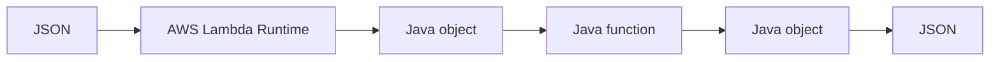
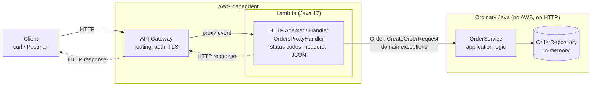

# Orders API — Serverless REST API with AWS Lambda and API Gateway

Java 17 · Maven · AWS Lambda · Amazon API Gateway · JUnit 5

> Items marked **TODO (author)** need to be completed by the author after deploying / experimenting.
> Everything else is derived from code that exists and passes `mvn test`.

## 1. Build and test

```bash
mvn test       # 29 tests, no AWS needed
mvn package    # produces target/orders-api-1.0.0.jar (shaded, ~3.4 MB)
```

Deploy both architectures (needs AWS credentials and an execution role): see [`deploy/deploy.sh`](deploy/deploy.sh).

```bash
ROLE_ARN=arn:aws:iam::<account>:role/<lambda-role> REGION=us-east-1 ./deploy/deploy.sh
```

## 2. API contract (designed before coding)

| Operation | Request | Success | Errors |
|---|---|---|---|
| Create order | `POST /orders` body `{"customerId","product","quantity"}` | `201 Created`, `Location: /orders/{id}`, body = the created order | `400 INVALID_REQUEST` (missing/blank field, quantity ≤ 0, malformed JSON) |
| Get order | `GET /orders/{id}` | `200 OK`, body = order | `404 ORDER_NOT_FOUND` |
| Find by customer | `GET /orders?customerId={customerId}` | `200 OK`, body = JSON array (empty array if none) | `400 INVALID_REQUEST` if `customerId` missing |
| Delete order | `DELETE /orders/{id}` *(final challenge)* | `204 No Content`, no body | `404 ORDER_NOT_FOUND` |
| Any | — | — | `500 INTERNAL_ERROR` for unexpected failures (no internals leaked) |

Order: `{"id":"ORD-001","customerId":"CUST-42","product":"MacBook Air","quantity":1}`

Error: `{"error":"ORDER_NOT_FOUND","message":"Order ORD-999 does not exist"}`

### Design questions

- **Resources:** `orders` (collection) and `orders/{id}` (a single order). Customers are not a resource of their own here; they are a filter on orders.
- **Why `/orders/{id}`?** The id *identifies* one specific resource, so it belongs in the path: stable, cacheable, bookmarkable, and `DELETE`/`PUT` naturally reuse the same URL.
- **Why is `customerId` a query parameter?** It does not identify a resource; it *filters* the collection `/orders`. Filters are optional/combinable (later `&status=...`), and the result is a collection, not a single entity.
- **What does `POST /orders` return?** `201 Created` + the created order (with the server-generated id) + a `Location` header pointing to the new resource.
- **When an order does not exist:** `404 Not Found` with the standard error body. An empty search result is *not* an error: `200` with `[]`.
- **What does an error contain?** A stable machine-readable `error` code (clients branch on it) and a human-readable `message`. Never stack traces or class names.

## 3. Checkpoint 1 (plain Java)

- *Testable without AWS?* Yes — `OrderServiceTest` only uses `OrderService` + `InMemoryOrderRepository`.
- *Web server needed?* No. *Spring Boot?* No.
- *What does the JAR contain?* The compiled project classes (`domain`, `application`, `lambda`) plus, because of the shade plugin, all dependencies (Jackson, AWS Lambda libs) in a single "fat" JAR — Lambda needs everything in one artifact.
- *Which parts know about HTTP?* Only `lambda.proxy.OrdersProxyHandler` (status codes, headers, JSON bodies). `lambda.direct.*` only knows a *tag convention* for errors (see below). `domain` and `application` know nothing about HTTP or AWS.

## 4. Lambda: JSON ⇄ Java (Part II)

Handlers implement `RequestHandler<I, O>`. The Lambda Java runtime reads the invocation payload and uses Jackson-based serialization to convert the JSON into the type `I` declared in the generic signature (`CreateOrderRequest`), calls `handleRequest`, and serializes the returned `O` (`Order`) to JSON. `Map<String,String>` and `List<Order>` work the same way. Unknown JSON fields / missing fields: **TODO (author): verify on the deployed function** (e.g. send `quantity` as a string, omit `product`, add an unknown field) and record the observed output.

Direct invocation:

```bash
aws lambda invoke --function-name orders-create \
  --cli-binary-format raw-in-base64-out --payload file://events/create-order.json out.json && cat out.json
```

**TODO (author):** paste at least two invocations with different inputs and their outputs here.

Flow:



## 5. Architectures

### Architecture A — API Gateway transformation (non-proxy), stage `a`

- 3 small Lambdas (`direct.*`) receive plain POJOs / maps: `{"id":"ORD-42"}`, `{"customerId":"CUST-42"}`, or the order JSON.
- Mapping templates in [`deploy/templates`](deploy/templates) extract path/query params.
- **Status codes are chosen by API Gateway**, not by Lambda. Lambda can only return a value or throw. Convention: handlers throw `TaggedApiException` with message `[404] {json}`; API Gateway matches `^\[404\].*` (selection pattern) → HTTP 404 and a response template strips the tag.
- Known limitations (observed while designing): a malformed JSON body on `POST` fails inside API Gateway's `$input.json` template (not a clean app-level 400); `201` for create is a configuration choice, not code.

### Architecture B — Lambda proxy + HTTP adapter, stage `b`

- One Lambda: `proxy.OrdersProxyHandler` receives the full API Gateway event (see [`events/`](events)), routes on `resource` + `httpMethod`, reads `pathParameters` / `queryStringParameters` / `body`, and builds the HTTP response (status, headers, JSON).

Where each piece of the proxy event lives:

| Info | Field |
|---|---|
| HTTP method | `httpMethod` |
| Path | `path` (concrete) / `resource` (template, `/orders/{id}`) |
| Path parameters | `pathParameters` |
| Query parameters | `queryStringParameters` |
| Headers | `headers` / `multiValueHeaders` |
| Body | `body` (string, `isBase64Encoded`) |

### Final architecture diagram



Dependency rule: `lambda.*` → `application` → `domain`. Never the other way around.

## 6. Checkpoint 3 — what API Gateway does in Architecture A (draft, review)

Routing; extracting path and query params; building the Lambda input (request templates); required-param validation (`method.request.*`); choosing status codes (selection patterns); transforming errors into the error body (response templates).

- **Advantages:** Java stays trivially simple (POJO in/out, no AWS classes in handlers); behavior is visible/editable without redeploying code.
- **Disadvantages:** HTTP contract is split between Java (error codes/messages) and Velocity templates + regexes (status codes), which are hard to unit-test locally, easy to get subtly wrong, and invisible from the Java code; one Lambda + several templates per operation; error handling relies on matching text in `errorMessage`.

## 7. Architecture comparison (draft, review against your own experience)

| Question | A (mapping) | B (proxy + adapter) |
|---|---|---|
| More API Gateway config? | **A** — per method: request template, 4 method/integration responses, regexes | Minimal: method + `AWS_PROXY` integration |
| More Java infra code? | Less (tiny handlers + `TaggedApiException`) | **B** — router + HTTP mapping in `OrdersProxyHandler` |
| Easier to test locally? | Java part yes; templates/status mapping **no** (need deployment) | **B** — whole HTTP behavior unit-tested (`OrdersProxyHandlerTest`) |
| Where are status codes? | API Gateway selection patterns (+ tag convention in Java) | Java adapter |
| 3 → 30 operations? | 30 × (templates + responses) in config; sprawl | Router grows; can split into per-route handlers while keeping the same adapter pattern |
| Cleaner business logic? | Same in both — `OrderService` is untouched | Same |
| Easier for a new developer? | Must read Java **and** API Gateway config | Everything in code, in one language |
| Choice for a larger system | | **B** (or an OpenAPI-defined API), because the contract lives in testable, versioned code |

**TODO (author):** justify in your own words and confirm with what you observed deploying both.

## 8. AI-assisted development — critique of the agent's decisions

Drafted from the decisions the assistant actually made in this repository; **TODO (author): confirm, disagree, or replace with your own** (the assignment grades your critical evaluation).

1. **Decision:** `OrderService` throws domain exceptions; the adapter maps them to HTTP. *Why:* keeps business code free of HTTP. *Alternative:* service returns `Result` objects. *Implemented:* exceptions, because they keep the happy path simple.
2. **Decision:** Order/request as mutable beans, not records. *Why:* Lambda's Jackson-based (de)serialization is safest with no-arg constructor + setters. *Alternative:* records. **TODO:** decide.
3. **Decision:** one Lambda for the whole API in Architecture B vs. one per operation in A. *Alternative:* one Lambda per route in B too. **TODO:** discuss cold starts, blast radius, deploy size (one fat JAR is shared anyway).
4. **Decision:** errors in Architecture A as `[status] json` exception messages. *Why:* only mechanism that lets Lambda influence the status code in non-proxy. *Downside:* stringly-typed coupling with API Gateway regexes.

## 9. Final challenge (DELETE) — see [`docs/PREDICTION.md`](docs/PREDICTION.md)

The prediction must be written and **committed before** implementing DELETE.

## 10. Demo video checklist

`mvn test` · `mvn package` · `aws lambda invoke` · deployed POST (201) · GET (200) · GET missing (404) · POST invalid (400) · DELETE (204 / 404) · this diagram.
